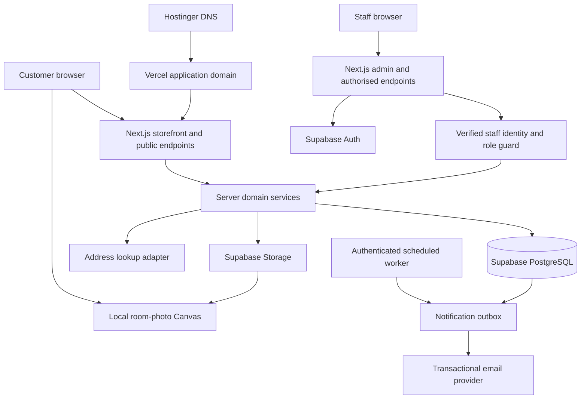

# Oakmere Living — Technical Implementation Plan

Version: 1.0 | Updated: 6 October 2026 | Status: implementation-ready design; application not yet built

Companion authority: [Project implementation plan, v0.2](PROJECT_IMPLEMENTATION_PLAN.md). That document owns business requirements and acceptance IDs. This document owns the implementation design, contracts, task dependencies and verification approach. Later explicit user answers take precedence; record any change in both affected documents.

The storefront name **Oakmere Living** is provisional and configurable. This is a fresh, single-store UK furniture project. The complete agreed feature set is intended for launch. The user requests a two-day delivery target; this plan defines an aggressive implementation sprint, not a claim that production readiness has already been achieved.

## 1. Decisions that developers must preserve

| Decision | Implementation consequence |
| --- | --- |
| Fresh build in this workspace | Do not look for or depend on an earlier application |
| Vercel application hosting | Use supported Next.js server execution; no long-running local server or local-disk persistence assumptions |
| Hostinger domain later | Connect registrar DNS to Vercel; the application does not move to Hostinger |
| Cash and card on delivery | No online payment gateway/card-entry form, bank-transfer screen or finance integration in current scope |
| Order-taking and showcasing platform | Sami's team confirms and fulfils orders manually; build useful staff tools without fleet/warehouse automation |
| Mixed fulfilment | Stocked, supplier-sourced and made-to-order modes per sellable variant |
| Supplied catalogue and images | Repeatable import, preserve source flags/IDs, admin becomes ongoing catalogue authority |
| Complete launch scope | Swatches, appointment management, colour previews and room planner remain required |
| Reference-derived delivery defaults | Editable policy version with provenance; unresolved service/coverage cases go to review |
| Two-day target | Work in short tested increments inside one full release; do not report incomplete functions as delivered |

No multitenancy, vendor accounts, separate mobile app, microservices, external search cluster, ERP, live driver tracking or customer account requirement. The architecture may grow later, but should not include speculative infrastructure now.

## 2. Selected stack and why

| Layer | Selection | Purpose |
| --- | --- | --- |
| Application | Next.js App Router, React, TypeScript with strict checking | Public HTML rendering and server endpoints alongside interactive UI |
| Styling | Tailwind CSS with project design tokens | Consistent responsive storefront/admin and straightforward maintenance |
| Database | Supabase-managed PostgreSQL | Durable relational records, transactions, constraints and concurrency protection |
| Staff identity | Supabase Auth with server-side cookie integration | Invite-only staff login, recovery, session validation and MFA support |
| Media | Supabase Storage | Durable original/product/cutout/preview assets and signed uploads |
| Data access | Supabase server clients, typed DTOs and versioned SQL functions | One data stack; transactional operations implemented in PostgreSQL |
| Validation | Zod or equivalent shared schemas | Explicit request and configuration validation; database constraints remain authoritative |
| Email | Resend adapter and transactional outbox | Customer/team updates with persistent retry state |
| Address lookup | Provider adapter; select a licensed complete-address service at configuration time | Full address selection plus manual entry; no fabricated address results |
| Images/tools | Browser Canvas, pointer controls and Web Worker where useful | Private room composition and deterministic masked colour previews |
| Tests | Vitest, Playwright, accessibility checks and database integration tests | Business rules, critical journeys, access control and rendering |
| Hosting | Vercel commercial-eligible plan | Managed Next.js delivery, preview environments, logs and scheduled worker calls |

Use a supported stable Next.js release compatible with the selected APIs; Next.js 16 documentation is the researched baseline. Resolve exact supported package/runtime versions at bootstrap, commit the lockfile, set Node `engines` and use the same runtime locally, in CI and on Vercel. Do not install an unverified “latest” combination independently in each environment.

Use Supabase SQL migrations rather than adding a second ORM in the first release. Every table change, index, policy and function belongs in a migration. Generate database TypeScript types after migration changes. Never implement a supposedly atomic order using several independent HTTP database writes.

Accounts and production keys have not been configured. Selection of a provider in this plan does not mean an account exists or that a paid plan has been purchased. Keep providers behind small adapters so an unavailable service does not require rewriting business logic.

## 3. System layout and trust boundaries



The browser supplies selections and intent, never authoritative totals, inventory, staff roles or payment state. Server code validates input and calls domain services. PostgreSQL enforces invariants for competing requests. Storage holds media bytes; database rows hold metadata and approved associations.

Room photos are a separate privacy boundary: file bytes stay in browser memory, are never sent to Next.js, Supabase, analytics, email or an image service, and are discarded on refresh/leaving the tool. Saved product imagery and admin-generated previews are business assets and may be stored remotely.

## 4. Repository structure and conventions

Create application source in the existing workspace root, preserving all supplied files and plans. Proposed structure:

```text
app/
  (store)/                 home, shop, products, content, services, basket, checkout
  admin/                  staff login and protected management pages
  api/                    validated JSON/upload/order/worker endpoints
  robots.ts
  sitemap.ts
components/
  ui/                     shared primitives
  storefront/             cards, filters, galleries, navigation
  checkout/               address, access, delivery and review steps
  admin/                  tables, forms, variant/media editors
  previews/               canvas, masks, room placement and export controls
lib/
  domain/                 catalogue, quotes, orders, stock, payments, services
  server/                 auth guards, clients, repositories, logs and rate limits
  validation/             Zod request/configuration schemas
  adapters/               email, address lookup and media storage
  presentation/           public DTOs, money/date formatting, SEO builders
  config/                 typed configuration and feature prerequisites
workers/                  browser image-processing worker code
supabase/
  migrations/             tables, constraints, indexes, RLS and RPC functions
  seed.sql                synthetic development/test fixtures only
scripts/                  catalogue validation/import, media transfer, launch checks
tests/
  unit/
  integration/
  e2e/
docs/
  research/
  operations.md
  deployment.md
  verification.md
public/                   approved static identity assets only
```

Use `server-only` boundaries for privileged clients/secrets. Components must not import server modules into client bundles. Domain functions expose explicit input/output types, accept dependencies for testing and do not depend on component state. Route handlers stay thin: parse → authorise/rate-limit → service → typed response.

Keep source JSON out of `public/`. Do not ship provenance, draft products, supplier identifiers or every original image URL in the browser bundle. Do not use the JSON file as the production database.

Naming: UUID primary IDs; snake_case SQL; camelCase TypeScript; UTC timestamps; `Europe/London` for display/booking rules; integer GBP pence for money. Brand name, contact details and service text come from settings/content records, not repeated string literals.

## 5. Data model and invariants

Common conventions: `id`, `created_at`, `updated_at`; `version` for records edited concurrently; foreign keys with deliberate delete behaviour; actor IDs where relevant. Use `timestamptz`, non-negative money checks, integer quantity checks and constrained status values. Do not store money as floating point.

| Entity | Important fields and relations | Invariants |
| --- | --- | --- |
| `store_settings` | singleton; brand, contacts, legal identity, tax display, enabled services, operating mode | Validated/versioned; private values excluded from public DTO |
| `staff_profiles` | auth user ID, role, active, display name | Only owner can grant/revoke; client metadata cannot assign roles |
| `categories` | name, slug, parent, description, SEO fields, sort, published | Unique slug; prevent parent cycles |
| `products` | slug, name, description, product type, primary category, status, dimensions/specifications, SEO, review state | Unique slug; publication validation; archive retains references |
| `product_categories` | product/category pair | Unique pair |
| `variants` | product ID, SKU, option labels/values, configuration key, price/compare price, fulfilment mode, lead-time fields, active | Unique product/configuration; non-negative integer price; genuine combinations only |
| `inventory` | variant ID, on_hand, reserved, enabled | Unique variant; stocked availability = on_hand − reserved; never below zero |
| `inventory_movements` | variant, order, kind, quantity, reason, actor, timestamp | Immutable ledger; unique business-event key |
| `media_assets` | storage key, hash, MIME, dimensions, kind, provenance, status, creator | Keys generated by server; processing/approved state separate |
| `product_media` | product/variant, asset, order, alt text, role | Correct selected-variant association; public only approved assets |
| `source_records` | source_site, source_product_id, source_url, raw payload, flags, import run, linked product | Unique source pair; private provenance |
| `import_runs` | file checksum, schema version, counts, report, timestamps | Idempotent source mapping; no silent live overwrites |
| `delivery_policies` / `delivery_rules` | version, state, zones/exceptions, method, charges, lead-time text, source/date | Deterministic priority; active version immutable; edits create a new version |
| `checkout_quotes` | guest/session hash, item/pricing fingerprint, postcode/access fingerprint, policy version, totals, expires_at | Server-created; short expiry; cannot be reused for a different basket/address |
| `orders` | order number, guest ownership hash, contact/address/access snapshot, method, statuses, totals, review flags, policy/version, notes | Unique order number; monetary snapshot immutable; no public list access |
| `order_items` | order, product/variant IDs, name/options/image/price/tax/quantity snapshots | Historic content survives catalogue edits; quantity positive |
| `order_events` | order, event, before/after, reason, actor, timestamp | Append-only; redact unnecessary sensitive data |
| `payment_entries` | order, receipt/refund type, method, amount, reference, actor, idempotency key | Manual actual receipts only; no PAN/CVV/PIN; ledger corrections use compensating entries |
| `idempotency_records` | scope, key, request hash, resource ID, result state | Unique scope/key; same key with different payload rejected |
| `notification_outbox` | event key, recipient/template data, status, attempts, available_at, lease_until, provider ID | Unique event key; bounded retries and explicit failed state |
| `fabrics` / `swatch_requests` / `swatch_items` | approved fabrics; request contact/address/status; selected fabric snapshots | Maximum four distinct samples; no source-only fabric silently advertised as stocked |
| `showrooms` / `appointment_slots` / `appointments` | real venue; UTC interval/capacity; request/customer/status | Atomic capacity allocation; cancelled booking releases once |
| `content_pages` / `redirects` | structured blocks, slug, SEO, publication; old/new path | Safe rendering; unique live slug; redirect loop prevention |
| `reviews` | product/order link, rating, text, source, moderation, verified flag | Verified flag requires actual evidence; no generated reviews |
| `contact_requests` | type, product/order context, supplied contact, message, status | Persistent inbox even when email fails; spam controls |
| `audit_events` | actor, action, entity, safe before/after, timestamp | Critical staff changes recorded; no secrets in payload |

Indexes: published products/category membership; product slug; variants by product; source pair; order number/date/status; pending outbox by availability; swatch/appointment status; slot time; audit entity/time. Index staff order search deliberately and restrict exports. At 108 initial products, PostgreSQL search is sufficient.

An optional product specification JSON field is suitable for extra furniture attributes. Core price, SKU, status, dimensions used by filters and inventory must remain typed/queryable. Preserve raw ambiguous measurements internally until labelled correctly; never coerce unlabelled “190 x 240” into width/depth arbitrarily.

## 6. Schema migrations and transaction boundaries

Suggested migration order:

1. Enums/settings/staff roles and audited role helpers.
2. Catalogue/categories/variants/media/provenance, indexes and publication checks.
3. Inventory and delivery policies/quotes.
4. Orders/items/idempotency/events/payment ledger.
5. Outbox, contact inbox, swatches, appointments, content/reviews.
6. RLS, restricted RPC execution grants and storage policies.
7. Synthetic fixtures and seeded editable delivery/reference settings in non-production only.

All business mutations that span records use one PostgreSQL function/transaction: `create_order`, `cancel_order`, `record_payment`, `record_refund`, `change_fulfilment`, `reserve_appointment`, `cancel_appointment`, `publish_product`, and stock adjustment. No email/provider call occurs inside a locked transaction.

SQL functions are not automatically trusted merely because they run in the database. Limit execute grants to the intended server/staff roles; revoke default PUBLIC/anon execution. For any `SECURITY DEFINER` function set an explicit safe `search_path`, qualify objects, verify actor permissions and keep the function narrow. Avoid a generic arbitrary-table write RPC. [Supabase function guidance](https://supabase.com/docs/guides/database/functions).

Release migrations explicitly in CI or an authorised deployment step, not from every server request or concurrent Vercel build. Prefer additive/backward-compatible changes. Data removal follows a later migration after deployed code no longer uses the field.

## 7. Authentication, permissions and customer privacy

Staff authentication uses Supabase Auth with the current server-side cookie integration. Validate the identity on the server using the supported verified claims/user method; do not trust unverified cookie contents. Handle session refresh correctly, logout/revocation, inactive staff and recovery. Never publicly cache a response that sets authentication cookies. [Supabase SSR guidance](https://supabase.com/docs/guides/auth/server-side/creating-a-client?queryGroups=framework&framework=nextjs).

No public staff signup. Create/invite the initial owner through a protected setup action or provider console; no default password committed in seeds. Staff roles live in protected database rows. Recommended roles: owner, catalogue, operations; read-only can be added without changing the ownership model.

Enable RLS on exposed tables. Anonymous database access to private records is denied. Staff reads/mutations have role policies. Private source, order, audit, settings secrets and request tables never receive anonymous select access. Privileged service credentials can bypass RLS, so server authorisation remains mandatory for every privileged endpoint. [Supabase RLS guidance](https://supabase.com/docs/guides/database/postgres/row-level-security).

Public storefront data is returned by explicit server DTOs containing only published fields. Prefer a narrowly scoped published-catalogue view/query; never serialise a complete internal database row. Service-role clients are server-only and isolated from user-session clients. A caller-supplied `staffId`, `role`, `price` or `paid` field must never influence authorisation or financial state.

Guest orders belong to an opaque signed session cookie; store its ownership hash. Order numbers are identifiers, not passwords. Immediate confirmation is authorised against that session. Email status links use high-entropy expiring tokens stored hashed; exchange the token for scoped access and remove it from the address bar. Use `Referrer-Policy: no-referrer` and redact tokens from logs. No status page appears in a sitemap or shared cache.

Protect mutations with same-origin/CSRF controls appropriate to the framework, secure cookies and content-type validation. Enforce a distributed rate limit for auth, lookup, quote/order creation and forms; an in-memory counter is insufficient on multiple serverless instances. Use database-backed counters initially, with retention/cleanup. Add a challenge only where observed abuse warrants it.

## 8. Catalogue ingestion and ongoing editing

Implement separate `validate`, `import` and `transfer-media` commands. They must support dry run and report output. The original JSON is immutable input. Validate the full 108 records and reconcile expected 64/44 source counts, 73 ready/35 draft statuses and three duplicate groups. Report all 45 missing `specifications.Dimensions` fields without claiming the other dimensions are verified.

Import source keys exactly; internal UUIDs are independent. Map categories through an explicit slug table. Preserve integer/string source IDs as strings in provenance. Convert decimal pounds to integer pence with decimal-safe parsing and reject invalid precision rather than multiplying a binary float blindly.

`base`, `fixed` and `from` remain distinct. Missing or unlabelled variants cannot become a made-up default SKU. Related size options create family links only where referenced source products exist. Never cross-merge products merely because names match. A duplicate review resolution records survivor/link/reason and keeps provenance.

First import populates drafts and eligible public candidates. Source `draft` remains private. `ready` permits validation for publication, not bypassing it. Keep a clear demo environment where fixtures can be browsed; production publication must have correct sellable configurations or use a contact/quote-only product state. Incomplete product data must not prevent the rest of the catalogue/admin from working.

After staff edits, rerunning an import updates provenance and proposes a diff; it must not overwrite staff-managed prices, descriptions or stock automatically. Provide explicit per-record apply/skip and an import report. Repeating unchanged import must not duplicate variants/media or delete products.

Media transfer is bounded and resumable: allowlisted supplied hosts, HTTPS, limited redirects/time/bytes, MIME sniffing, no private-network/metadata addresses, content hashing and duplicate reuse. Record failed URLs per asset and allow admin replacement. Product galleries use owned storage URLs when transferred; no dependence on permanent competitor hotlinks.

## 9. Rendering, search, navigation and caching

Public home, category, collection, product, guide and policy pages render meaningful HTML on the server. Use small client components for filters, gallery, variant selectors and basket controls. Render price/options, product description and crawlable links without requiring a client fetch after hydration.

Use one explicit caching model across the application. With the selected Next.js Cache Components approach, cache only public catalogue/content reads with named tags and lifetimes; invalidate related product/category/sitemap data after committed publication changes. Identity, quotes, admin data, customer records and checkout are uncached. Do not mix incompatible previous-model route caching assumptions into the implementation. [Next.js revalidation guidance](https://nextjs.org/docs/app/getting-started/revalidating).

For price/availability correctness, order creation always reads current transactional data regardless of public-page cache age. On product update, invalidate all affected category/range paths and metadata; test the real deployment, not only development mode. If a withdrawn item persists briefly in a cache, basket/checkout must still reject it with a clear explanation.

Search/filter plan: PostgreSQL text search or normalised case-insensitive matching over approved names/descriptions and filters for category, price, material, shape and supported colour. Use indexed range/filter fields, paginated results (initial recommendation: 24 products), deterministic sort with ID tie-breaker and an allowlist of query parameters. Do not add Elasticsearch for this catalogue size.

Mobile filters use an accessible dialog with apply/reset, selected-count and URL state. Back/forward restores results; search has a useful empty state. Public filter URLs use the canonical/noindex strategy in section 17. No client downloads the whole private catalogue to filter locally.

## 10. Basket, delivery quote and request contracts

Basket local storage contains only a schema version, variant IDs, quantity and optionally a last-seen price for change messaging. It contains no delivery address or payment data. Validate hydration, migrate/clear obsolete basket formats safely and reconcile against the server. Different variants remain separate lines.

The chosen variant must determine name/options/image/price together. Mandatory selectors are explicit; a colour preview cannot create a sellable variant. Disabled combinations explain unavailability. Add-to-basket announces success accessibly and preserves browsing context.

Public endpoint contract, proposed paths:

| Endpoint | Input | Result / rules |
| --- | --- | --- |
| `GET /api/catalogue/search` | allowlisted query, filters, sort, page | Published DTO page; bounded page size |
| `POST /api/address/lookup` | postcode | Complete address options through licensed adapter; typed outage/no-match errors |
| `POST /api/checkout/quote` | variant IDs/quantities, postcode/address/access/service | Quote ID, policy version, exact/estimated state, expiry, item changes and totals |
| `POST /api/orders` | quote ID, contact/address/access, cash/card delivery, terms version; idempotency header | Persisted order or structured conflict requiring renewed review |
| `GET /api/orders/[id]` | authorised guest/staff session | Limited order/status DTO; no enumeration |
| `POST /api/contact` | validated contact, message, optional product/order context | Saved request ID; notification separately queued |
| `POST /api/swatches` | up to four approved fabrics and postal contact | Saved request; snapshots and outbox |
| `POST /api/appointments` | real slot, contact and notes | Requested/confirmed state according to slot policy; atomic capacity check |

Use a consistent response envelope with `code`, user-safe `message`, `fieldErrors` and `requestId`. Recommended statuses: 400 malformed, 401 unauthenticated, 403 forbidden, 404 unavailable resource, 409 stale quote/stock/concurrency, 422 field/business validation, 429 throttled, 503 temporary dependency failure. Never return stack traces or secrets.

Quote lifetime starts at 15 minutes as an implementation default. Bind quote to basket fingerprint, address/access/service and active policy version. Recalculate when any relevant field changes. Expose monetary amounts in integer pence plus currency; UI formats once with `Intl.NumberFormat('en-GB', ...)`.

Full card-on-delivery/COD order: due now = 0; due on delivery = total. No “payment successful” message. The order confirmation clearly states payment method, outstanding balance and whether fulfilment/delivery is awaiting team confirmation.

## 11. Delivery rules and address service

Versioned delivery rules contain: priority, inclusion/exclusion match, geography, service, fixed/conditional charge, access conditions, estimate, review trigger and source verification state. Explicit exclusion/manual-review rules win over broad inclusions. Overlapping ambiguous rules fail to review, not silently to the cheapest rate.

Seed the initial delivery policy from section 10 of the project plan, which owns the reference-derived amounts and estimates. Northern Ireland/islands and unresolved remote areas require review; an upstairs “from” amount must not become a universal fixed quote. Optional assembly/removal/redelivery figures remain inactive unless configured as real services. Keep those business values in versioned settings rather than duplicating them in component code or multiple documents.

Customer text: “Estimated delivery, subject to confirmation by our team.” For manual review, show the reason and submit an enquiry/order request only if the interface clearly states that total/service is awaiting agreement. An unpriced delivery must never be labelled £0 or create a binding-looking final total. Once staff supplies a revised quote, record its version and customer acceptance before confirming the order. Do not silently change an existing accepted total.

For stocked products, combine region estimate with handling availability; for supplier/made-to-order items, use the product's approved lead time or state that timing is to be confirmed. Never show a retailer's 2–4-day promise for every made-to-order sofa.

Full address lookup requires a licensed provider with find/retrieve operations behind `AddressLookupAdapter`. Server keeps provider keys private. `Postcodes.io` may help postcode/geographic validation, but it is not a complete premises-address database; it cannot populate a list of actual flat/street addresses. [Postcodes.io overview](https://postcodes.io/docs/overview/).

Implement manual entry as a first-class path. If provider credentials are absent, show manual entry and an honest unavailable lookup state; do not return mocked addresses. The full lookup feature remains configuration-incomplete until a real provider is tested. Use synthetic provider responses only in automated tests/clearly isolated demo mode.

Coverage needs maintained geographic/exclusion data; a UK postcode regex or `country = Scotland` is insufficient to identify every island. Unknown or unresolved postcode classification routes to team review. Normalisation, lookup match and coverage result are separate fields. Retest charges/coverage after edits.

## 12. Atomic order creation and mixed stock

`create_order` performs one transaction:

1. Verify the signed guest/session scope, validated contact/access fields, enabled payment method and accepted terms version at the API boundary.
2. Look up `(guest scope, idempotency key)` and request hash. Return the existing authorised result for an identical retry; reject a different payload using the same key.
3. Lock the quote and relevant variant/inventory rows in stable ID order. Verify quote expiry, policy version, publication, exact variant combinations and quantities.
4. Recompute all prices/discounts/delivery from current records. If they differ from the accepted quote, return a conflict for customer review; no order/reservation is committed.
5. For stocked variants, atomically reserve only if available quantity covers demand. For supplier/made-to-order variants, require a configured orderable/review policy, not imaginary warehouse stock.
6. Insert order and immutable line/charge/address/policy snapshots, initial events, reservations/commitments and outbox records.
7. Complete the idempotency record with the order ID and commit. Unique constraints arbitrate concurrent duplicate requests.
8. Return the confirmation link/DTO to the same authorised session. Notification processing happens after commit.

Concurrent identical requests must converge even if both start before either inserts. Use the unique key/transaction conflict path to refetch the committed result, with bounded retry; do not rely on “check then insert” alone. Transaction exceptions roll back all stock/order/outbox changes.

Initial inventory policy: reserve stocked items on successful order placement, retain until cancellation or fulfilment; put stale pending orders in the staff attention queue. Do not automatically release a COD reservation on an arbitrary timer and then leave a supposedly confirmed order unallocated. A later expiration policy requires explicit states/notifications. Prevent abuse through rate limits, quantity limits and team confirmation.

Fulfilment modes:

| Mode | Availability behaviour | Staff action |
| --- | --- | --- |
| `stocked` | Enforce `on_hand - reserved` | Allocate, dispatch and decrement physical stock at the documented event |
| `supplier` | Configured availability/limit and lead time; otherwise review | Confirm supplier before confirming dispatch |
| `made_to_order` | Supported variant/options and approved capacity/lead time; otherwise review | Confirm specification and expected delivery |

Record reservation release and physical decrement separately and idempotently. For dispatch, consume reservation and decrement on_hand once. Cancel before dispatch releases reservation; a returned item increases saleable stock only after actual receipt/inspection. Mixed-mode orders present combined timing honestly, normally one team-confirmed delivery unless split delivery is explicitly introduced.

## 13. Payment ledger, fulfilment and staff operations

Payment methods are exactly `cash_on_delivery` and `card_on_delivery`. Staff record successful collection, amount, method, timestamp and a limited reference. Card processing occurs on the team's external terminal; the website neither collects card numbers nor automatically knows terminal success.

`record_payment` verifies operations/owner permission, locks the order, checks the outstanding balance and writes an immutable receipt plus event. Duplicate event keys return the existing receipt. Reject over-collection or require a deliberate authorised adjustment workflow. Derive balance from charges minus receipts plus refunds; never let a generic order-edit endpoint set `paid=true`.

Statuses:

- Fulfilment: `pending_confirmation → confirmed → processing → dispatched → delivered`; branches for `cancelled` and `delivery_failed`.
- Payment display: `unpaid`, `partially_paid`, `paid`, `partially_refunded`, `refunded`; derived from ledger and order financial state, with failed attempts recorded as events that do not change balance.
- Quote review: `not_required`, `awaiting_team`, `awaiting_customer_acceptance`, `accepted`; separate from payment.

Add transition guards: cannot dispatch an order needing unresolved quote/specification agreement; cannot cancel a delivered order as though it were never fulfilled; returns/refunds use a distinct audited process. Delivery failure does not automatically refund, cancel or mark paid. Correct mistaken staff entries with compensating records and reasons.

Admin routes: dashboard, products/categories/media, orders/order detail, swatches, appointments/showrooms, content/reviews, settings, users (owner only), audit and notification failures. Tables support meaningful filters, accessible pagination and mobile detail views. Guard each page and API, including image upload signing and exports.

Use optimistic version checks for product/settings edits. If two staff edit the same version, return a conflict and preserve the second staff member's entered data for review. Payment/stock mutations use locks rather than relying on UI versioning.

## 14. Media and colour-preview implementation

Storage buckets: private original uploads and processing assets; approved catalogue derivatives for public display; private masks/source provenance. Use unguessable server-generated paths, content hashes, dimensions and immutable versioned keys. A database record is only `ready` after upload/finalisation verifies the actual object.

Prefer direct signed browser-to-storage uploads for staff media, then a protected finalise endpoint that validates object ownership, MIME/content, size and dimensions. Avoid routing all image bytes through a serverless request body. Supabase documents different upload approaches by file size; set a conservative project limit and use resumable upload when needed. [Storage upload guidance](https://supabase.com/docs/guides/storage/uploads/standard-uploads).

Initial limits to test: JPG/PNG/WebP only, 10 MB upload, decoded image ≤ 24 megapixels; downsample processing copies to bounded dimensions. Reject SVG/HTML/animation for product uploads initially. Strip unnecessary metadata and retain originals privately if operationally needed. Restrict image optimisation to approved storage domains.

Admin colour generation deliberately starts with a deterministic image workflow:

1. Upload a product photo; create/upload a transparent full-sofa cutout and an upholstery mask using polygon/brush controls with undo/redo. Masks exclude legs/background and preserve cushions.
2. Select a target colour and adjust strength. Worker recolours masked pixels using a luminance-preserving colour transformation; retain alpha and texture detail rather than painting a flat opaque overlay.
3. Show side-by-side original/preview and warnings for unrealistic black/white/highlight results. Adjust, retry or upload a dedicated actual photograph.
4. Save the generated preview to storage only on explicit admin action; link it to an already valid variant and label it “Colour preview”. Store source asset/mask/version/parameters for reproducibility.
5. Remove a preview/colour through normal variant archival rules; historic order media remains preserved.

This satisfies “generate a colour preview” without requiring a paid generative AI service. It does not automatically extract a perfect sofa from every photograph. Manual mask/cutout correction is an implemented part of the workflow, not a hidden developer task. If automatic segmentation is later required, assess provider/model/licence/quality separately and keep the same asset contract.

Test fabric texture, dark/light upholstery, loose cushions, thin legs and mask edges. Preview must not imply availability of an unapproved material or exact real-world colour. Publish actual variant photographs where available; previews are an explicitly labelled aid.

## 15. Browser room planner

The planner is client-only and dynamically loaded from its route. Keep its libraries/workers out of normal product/checkout bundles. Load only public approved cutouts/variant metadata from the catalogue.

Workflow and coordinate contract:

1. Validate JPG/PNG/WebP input, decode safely, correct orientation and downsample to a working bitmap (initial longest edge 2048 px). Enforce a decoded pixel limit to prevent mobile memory exhaustion.
2. Render the room image within an aspect-ratio-preserving viewport. Store placement points normalised to image dimensions, not CSS pixel positions.
3. User marks four points defining the placement region; order/validate the polygon, reject self-intersections/tiny regions and treat the lower pair as floor contact reference.
4. Load the complete transparent sofa cutout and fit it inside the region while preserving aspect ratio. Keep the sofa upright/front-facing; do not apply a perspective warp that stretches its shape simply because four points exist.
5. Offer accessible controls for scale, x/y movement, wall coverage, side gaps and floor anchor. Pointer dragging and keyboard controls modify the same normalised transform. Clamp safely but allow intentional repositioning/reset.
6. Export a PNG composition with room and sofa using the same render function at bounded output resolution. Verify cross-origin media headers so the canvas remains exportable.
7. “Add this sofa” transfers the real selected variant ID to basket; server still checks its current price/availability.

Four points are a placement aid, not calibrated physical measurements. Do not compute a guaranteed sofa fit from them. Show a compact visual-preview disclaimer and link to real dimensions/access guide.

No photo in localStorage, IndexedDB, service-worker cache, telemetry or remote upload. Revoke object URLs, terminate workers and release image/canvas memory on exit. On refresh, the user starts with a new photo; the regular basket can persist independently. Errors cover invalid/oversized file, image decode failure, missing cutout, export failure and changed/unavailable variant.

## 16. Swatches, appointments, reviews and content

Swatches: import the 70 reference fabric entries into a reviewable fabric catalogue, not automatically into stocked offerings. Staff selects available fabrics. Submission stores up to four unique approved fabric snapshots and contact/address; outbox confirmation and admin status transitions follow. Prevent duplicate clicks and configurable abuse/repeat requests. Do not imply dispatched samples until staff marks shipped.

Appointments: admin creates real showrooms and availability/capacity. Store actual slot instants in UTC with venue timezone `Europe/London`; handle daylight-saving ambiguous/nonexistent local times during slot generation. `reserve_appointment` locks slot, checks active booking count/capacity and inserts once. Define whether “requested” holds capacity (initial choice: yes until staff confirms/cancels). No fabricated venue is published if no address is configured; show an appointment enquiry route and an admin configuration task. This does not count as fully configured live booking until real slots exist.

Contact: save first, queue email second. Provide a staff inbox with status/notes; submission failure must be visible. Publish phone/WhatsApp only when actual business values are configured; never reuse retailer contacts.

Content: use a small typed block model (heading, paragraph, image, list, product links, FAQ) with safe rendering, draft/preview/publish and SEO fields. Avoid a large plugin CMS during this sprint. Policies keep version/date; checkout snapshots the accepted terms version. Guides explain actual dimensions/materials; no invented technical claims.

Reviews: moderate genuine submissions; rating range constraints, spam controls and source evidence. A completed order can support verification through a signed invitation. An empty state is acceptable when no reviews exist. Do not import other retailers' reviews or invent examples on production.

## 17. SEO implementation details

Use the business plan's route matrix. Set metadata base from a validated canonical production origin; do not derive it from an arbitrary Host header. Store product/category/page slugs centrally. Generate title/description/Open Graph consistently with editable overrides. Use one H1 and useful semantic content per page.

Initial URL policy:

- `/products/[slug]` is the canonical product page. `?variant=[id]` restores a selected variant and canonicalises to the base for the single-page variant design.
- `/sofas/[category]` and useful collections/guides self-canonicalise. Pagination remains crawlable and uses page-specific canonicals.
- Sort/filter/search URLs are noindex and excluded from sitemap; supported internal links are bounded. Only deliberately authored landing pages become indexable filters.
- Admin, basket, checkout, confirmations, private tokens and previews are noindex and never in the sitemap; private records also require authorisation.
- Archived products use accurate availability/useful content or relevant redirects/404/410 according to their lifecycle; no universal redirect to home.

JSON-LD derives from the same published product/variant data as the visible page. Escape `<` when serialising into script content. Do not invent GTINs, brand/manufacturer, review counts, stock status or shipping guarantees. Use valid Product/Offer and ProductGroup relationships where appropriate; include only approved business details. Validate representative real pages with Google's tools. [Product variant documentation](https://developers.google.com/search/docs/appearance/structured-data/product-variants).

Sitemap contains published canonical URLs only and actual content modification times. Add robots rules without blocking resources needed to render public pages. Verify first-response HTML, HTTP status, canonicals, structured data, navigation links and image alt text in tests. Sitemap and structured data cannot compensate for missing useful product content.

Keep protected/non-public previews noindex. Decide whether the initial stable `vercel.app` production host is genuinely public: if it is only a pre-domain review environment, noindex it. When a permanent domain arrives, update canonical origin, metadata, sitemap, email links, authentication allowlists and redirects; inspect Search Console. Do not leave both hostnames self-canonical and indexed as duplicate stores.

Analytics remains consent-aware and excludes personal information. Track order placement separately from payment collection; reporting may happen in the database/admin even before marketing analytics is configured. Search Console/property setup occurs on the actual owned production domain. Rich result eligibility and ranking are not guarantees.

## 18. Notifications, background work and resilience

Use an outbox because a successful order must survive email-provider failure. Insert the notification event in the same transaction as the order/request. The worker leases due rows atomically, processes bounded batches, sends through the provider adapter and records result/attempts. If a worker dies, an expired lease permits retry.

Use a stable provider idempotency key where supported. A timeout after provider acceptance can otherwise cause duplicate email on retry; treat this as at-least-once delivery, not an exactly-once promise. Keep retry delays/backoff and a capped failed state with admin resend. New manual resends have their own audit/event identifier.

Vercel scheduled calls trigger a protected worker endpoint with a secret; the database lease handles overlapping invocations. Do not rely on a fire-and-forget Promise after sending an HTTP response. Confirm scheduler frequency/limits for the actual plan. [Vercel cron guidance](https://vercel.com/docs/cron-jobs).

Email templates: order received/payment outstanding; order confirmed/revised quote; dispatch/delivery update; payment receipt/refund; swatch request/status; appointment request/confirmation/change; contact acknowledgement. Escape all user content. Staff notifications link to authenticated admin rather than including unnecessary addresses in subject lines.

Resend requires working credentials/sender configuration. A temporary Vercel domain is not an email sending identity owned by the store. Verify an owned sending domain or an already authorised sender before claiming email works; restricted test sending is only a test. Persist inbox/outbox and show admin setup failures meanwhile. [Resend Next.js guide](https://resend.com/docs/send-with-nextjs).

## 19. Environments, secrets and deployment

Environments: local/test, preview and production. Keep production customer data, Auth configuration and storage separate from demo imports/tests. Prefer separate Supabase projects for preview and production; never let pull-request previews write live orders. All deploys use a locked dependency tree and known migrations.

Planned environment template (names are proposed contracts, not real values):

```text
NEXT_PUBLIC_SITE_URL=
NEXT_PUBLIC_SUPABASE_URL=
NEXT_PUBLIC_SUPABASE_PUBLISHABLE_KEY=
SUPABASE_SERVICE_ROLE_KEY=
RESEND_API_KEY=
EMAIL_FROM=
OPERATIONS_EMAIL=
ADDRESS_PROVIDER=
ADDRESS_PROVIDER_API_KEY=
GUEST_SESSION_SECRET=
ORDER_LINK_SECRET=
CRON_SECRET=
APP_ENV=development
ALLOW_DEMO_DATA=true
LIVE_ORDERING_ENABLED=false
```

Use the provider's actual supported key types at setup; privileged keys never receive a `NEXT_PUBLIC_` prefix. Separate migration credentials from runtime credentials. Validate configuration on startup and report missing optional/required integrations clearly. Never silently fall back to fake success in production.

`LIVE_ORDERING_ENABLED` is an operational switch for maintenance/configuration readiness, not a substitute for implementing checkout. `ALLOW_DEMO_DATA` is false in production. Public readiness checks include genuine seller/contact configuration, method/service rules, safe catalogue and a working notification channel. A service with missing credentials must be visibly unconfigured in admin.

Deployment sequence: create owner-controlled Vercel/Supabase/email accounts → select compatible nearby regions after checking availability → configure separate environments → apply migrations → invite owner → upload/import controlled media/data → set environment variables → deploy preview → run acceptance → promote verified build → run production smoke checks. Confirm region choices for latency; UK-only residency has not been requested or verified.

Commercial deployment must use an eligible Vercel plan; Hobby is documented as non-commercial personal use. No purchase is performed by this plan. [Vercel Hobby documentation](https://vercel.com/docs/plans/hobby).

## 20. Hostinger domain and DNS runbook

1. Purchase the chosen available domain through the owner's Hostinger account when ready. The provisional name has not been checked for availability or legal clearance.
2. Add apex and `www` to the Vercel project. Choose one canonical production hostname (recommendation: `www` with apex redirect; final domain remains unknown).
3. At the authoritative DNS provider, enter the exact A/CNAME/verification values shown for that Vercel project. Do not copy another project's IP/CNAME or hard-code values from this plan.
4. Preserve existing MX/SPF/DKIM/DMARC/TXT records. A nameserver change is unnecessary if editing website DNS records suffices.
5. Verify Vercel domain/HTTPS status and both hostnames; test redirects with path/query preservation.
6. Update canonical site origin, auth/recovery redirect allowlists, emails, sitemap and any analytics/Search Console properties. The application, database and stored images remain where they were hosted.
7. Verify the old production hostname redirect/noindex strategy, crawler access, order-status links and staff login. Keep preview hostnames private/noindex.

These steps connect a domain; they do not migrate compute or database storage to Hostinger. [Vercel custom-domain documentation](https://vercel.com/docs/domains/working-with-domains/add-a-domain).

## 21. Testing and evidence required

| Layer | Tests that matter |
| --- | --- |
| Unit | Pence conversion, quantity limits, variant configuration keys, postcode normalisation, delivery precedence, quote fingerprints, money/stock ledger calculations, room transform bounds |
| Database integration | Anonymous/staff permissions, restricted RPC grants, double-submit uniqueness, last-item race, atomic cancellation/release, appointment last-slot race, ledger idempotency, outbox leases |
| UI/component | Conditional fields, accessible errors/focus, variant image/price consistency, empty/loading/error states, preview labels |
| E2E | Product → chosen variant → basket refresh → quote → cash/card delivery order → admin confirmation/receipt/delivery; swatches; booking; media/colour generation; room export/handoff |
| Failure cases | Lookup outage, stale price/quote, invalid/unsupported postcode, upload errors, email outage, expired session, double click, refresh after order commit, missing cutout |
| Search | Server HTML, canonical/robots/sitemap exclusion, Product data consistency, redirects and real 404 |
| Manual | Mobile Safari/Chrome, keyboard checkout/admin, screen-reader spot checks, image quality, correct exported canvas and owner operations trial |
| Operations | Redeploy persistence, database + media restore, rollback, production order smoke test and alert visibility |

Use deterministic synthetic stock/slots to prove races: two simultaneous orders for one remaining unit must produce one success and one stock conflict; two identical submissions must return the same order. Two simultaneous requests for one appointment slot must not overbook. Assert database outcomes, not just button states.

Map evidence to AC-01–AC-18 in the project plan. For online payment test cases in the inherited PDF, mark not applicable because the user selected delivery-only methods; card-on-delivery manual collection remains required. Do not label other failures “not applicable” to satisfy the deadline.

Run typecheck, meaningful tests and production build before deployment. Define package scripts during bootstrap (`dev`, `build`, `typecheck`, `test`, `test:integration`, `test:e2e`, catalogue commands). There are no runnable application scripts yet; the plan is not claiming these commands currently exist.

Performance: target the project plan's Core Web Vitals; record reproducible lab device/network conditions and later field data. Test home/category/product/checkout and the separately loaded planner. Accessibility requires manual verification as well as tooling. Security checks must include direct endpoint calls without the UI.

## 22. Two-day execution board

The following are target elapsed working blocks within the requested 48-hour window, beginning when implementation starts. They assume service access and focused implementation capacity. They are prioritisation checkpoints, not booked calendar dates or promises of person-hours. Full scope remains the target.

| Work package | Target block | Deliverable | Depends on | Acceptance mapping |
| --- | --- | --- | --- | --- |
| T01 Bootstrap | 0–3 h | App, pinned versions, design tokens, environment validation, preview deploy | Vercel/project access | AC-15, AC-17 |
| T02 Data/security | 3–7 h | Migrations, staff auth/roles, storage policies, synthetic fixtures | Supabase access; T01 | AC-01, AC-11 |
| T03 Transaction proof | 7–10 h | One product → quote → persistent delivery-payment order with concurrency checks | T02 | AC-04–09 |
| T04 Import/media | 10–14 h | 108-record report/import, image transfer, draft handling, category/variant model | T02 | AC-01–02 |
| T05 Storefront | 14–20 h | Home/catalogue/product/search/filter/gallery/variant/basket, responsive UI | T01, T04 | AC-02–03, AC-15 |
| T06 Checkout/admin | 20–26 h | Full address/access/delivery/review flow; product/order/admin state tools | T03, T05 | AC-04–11 |
| T07 Notifications/services | 26–31 h | Outbox, contact, swatches, slots/bookings, staff workflows | T02, sender/provider setup | AC-10, AC-12 |
| T08 Image tools | 31–38 h | Mask/cutout editor, saved colour previews, local room planner/export/basket | T04; early image feasibility check | AC-13 |
| T09 Content/SEO | 38–41 h | Editable pages, reviewed initial content, metadata/schema/robots/sitemap/consent | T05, content/settings | AC-14, AC-18 |
| T10 Full QA/recovery | 41–46 h | Critical e2e/accessibility/security/restore/redeploy verification and fixes | T01–T09 | AC-01–18 |
| T11 Release/handover | 46–48 h | Production rehearsal/deploy when gates pass; runbooks/evidence/outstanding list | T10 | AC-16–18 |

Bring a small mask/canvas feasibility test forward during T03/T04 so a difficult image workflow is discovered early. Likewise prove the transaction/auth/storage path before investing in every page. This is internal testing within the full build, not a separate reduced product release.

Dependencies to resolve while coding: managed accounts; verified sending identity; licensed address provider; actual business/contact/showroom/fabric settings; product ambiguities. Missing facts do not block design/schema/manual entry work, but their corresponding live features cannot be called verified until configured.

At each checkpoint, record completed evidence and remaining work. If the 48-hour target cannot be met, identify exact incomplete requirements and continue toward the same accepted scope; never hide a stub, skip stock/permission tests or claim a working live service from a static screenshot. Ongoing SEO optimisation and later measured conversion improvements remain post-launch work.

## 23. Deployment recovery and staff handover

Monitor checkout/order failures, queued/failed notifications, privileged access failures, upload errors and application health. Use request/order IDs in logs without full addresses, secrets, room images or card data. Staff dashboard shows actionable outstanding work.

Back up the database and storage objects independently; a database backup does not recreate missing media bytes. Choose actual provider backup/retention capabilities during setup, and add an owned export process where needed. Record recovery point/time objectives from the project plan and verify a restore to an isolated environment. Supabase automatic backup capabilities/plan have not been verified in this planning pass.

Rollback runbook: stop live ordering if correctness is affected → preserve order/ledger records → revert application to known build → ensure schema compatibility → replay/retry pending notifications safely → verify public/admin flows → reopen. Never roll back by deleting orders created after the deployment or restoring an old database over current financial records without a reconciled recovery procedure.

Handover includes local setup, environment variable definitions, database migrations/type generation, import commands and report, media ownership, deployment/DNS/rollback steps, backup restoration, staff role guide, product publishing, order/payment reconciliation, policy editing and acceptance evidence. Owner accounts retain control. No credentials appear in Markdown.

A new developer starts with README → project plan decisions → this document sections 1–7 → current T-work package and verification register. They must inspect actual code/migrations before assuming this planned layout has been implemented.

## 24. Completion checklist and planning status

The technical plan is complete when it specifies a coherent build path, data/permissions/contracts, full scope, deployment, tests and handover. The application is complete only when implemented acceptance evidence exists. As of this document's creation, only planning/research artifacts exist.

Open configuration facts: real legal seller/address/contact; final domain; service account credentials; verified email sender; actual showroom/slot/fabric availability; production product validity/media rights; final delivery exceptions and card-terminal operational readiness; tax/returns wording. The user has authorised reasonable editable reference defaults, so no further broad scope questionnaire is required. Treat unresolved facts honestly in UI/admin, and do not borrow a retailer's identity or guarantees.

References checked 6 October 2026 are linked at the relevant sections. Provider APIs, plans and limits may change; verify exact supported versions during bootstrap. The Corner Sofa reference remained inaccessible through the research tool. UK Sofa Shop's delivery page supplied provisional business defaults, not legal advice or proof of Sami's fulfilment capability.

| Version | Change |
| --- | --- |
| 1.0 — 6 October 2026 | Initial detailed technical roadmap incorporating the user's nine answers and full-scope two-day target |
